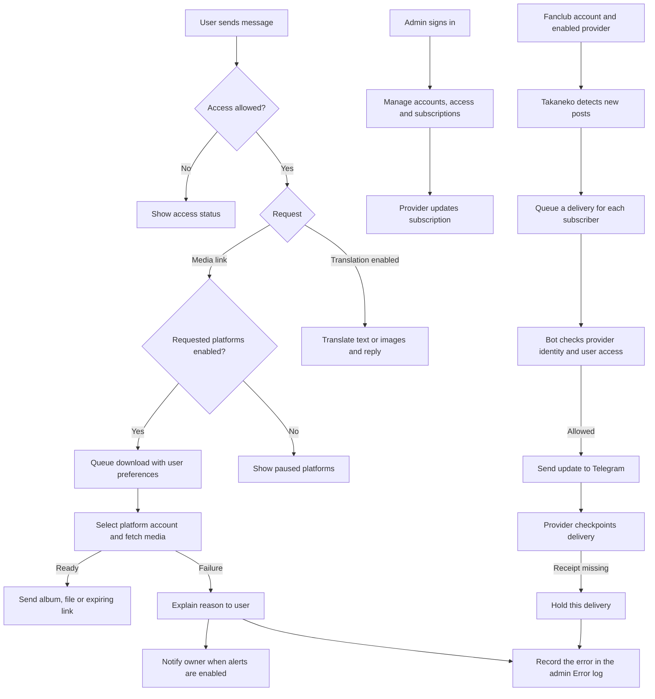

# Telegram Social Downloader

Download media in Telegram and receive subscriptions from connected services. The worker handles Instagram posts and Stories, TikTok, X, Threads, and YouTube videos and Shorts. An HTTPS web console manages the bot. The optional Takaneko service uses your own Fanclub account to send new posts to approved subscribers. Both services ship in the same release.

## What users can do

| In Telegram | Result |
| --- | --- |
| Open a private chat and send `/start` | Register with the bot. Access follows the operator’s approval policy. |
| Send a supported link, or several links together | Receive the media in the chat. The bot groups compatible photos and videos into albums and can deliver other files as documents. |
| Use `/download` in a registered group | Download from the message or its quoted content. The worker checks the requesting member’s access. |
| Change download preferences | Choose Instagram and TikTok content scope, Instagram Story scope, and supported video quality and HDR preferences for new requests. |
| Request a translation | Translate text or supported images in a private chat or registered group when a translation API key is configured. |
| Receive updates from a subscribed service | The provider selects recipients and submits updates for delivery through the bot. |
| Read a status or failure message | See the result in Telegram, including the reason when a request cannot finish. |

## What administrators can do

| Control | Actions |
| --- | --- |
| Features | Enable or pause Instagram, TikTok, X, Threads and YouTube downloads independently. Switch Telegram translation and OCR on or off, and control the installed Takaneko provider. |
| Users and groups | Review requests, approve or revoke users, set the access policy and manage registered groups. The configured owner has additional Telegram controls. |
| Takaneko subscriptions | Save a Fanclub refresh token, test the connection and manage subscribed recipients. |
| Error log | Read the latest 100 entries for failed, partial or paused downloads, Telegram push errors and provider health reports. Each entry shows its source, message and time when known. |
| Account pools | Import or update platform cookies, enable or disable an account, select a primary account or rotation policy, and test an account against a supplied post. |
| API credentials | Set up the Telegram Local Bot API and add, rotate or disable translation API keys. |
| Bot connection | Add or replace the bot token, check the connection, enable polling, set media limits and manage owner failure alerts. Each form saves its own settings. |

Open **Features** in the web console and choose **Pause** or **Enable** beside the function you want to change. The setting takes effect without a restart and survives upgrades. An existing batch waits when it reaches a paused platform and resumes in order when you enable it again. Work already in progress can finish. If a new message includes links from a paused platform, the bot names the platform so the user can resend the other links. Account pools, API keys and subscriptions are managed separately.

## How actions flow



## Deploy on Linux

Install on your own server, then enable **Deploy to production** in your fork to install published releases automatically or select a release from Actions. See the [deployment guide](docs/deployment.md).

## Install

Use Linux, Python 3.11 or later, and FFmpeg with ffprobe. Install Deno on the worker’s PATH for YouTube extraction. Use a dedicated operating system account. The example runs the bot components under that account.

```sh
python3 -m venv .venv
. .venv/bin/activate
python -m pip install .
install -d -m 700 /srv/telegram/data /srv/telegram/credentials /srv/telegram/run
install -m 600 .env.example .env
python -m media_bot.admin_auth
```

Copy the verifier to `MEDIA_BOT_ADMIN_PASSWORD_HASH`. Set your bot token, numeric owner ID, HTTPS origin and service paths in `.env`. For a web prefix, use a trailing slash, for example `MEDIA_BOT_BASE=/telegram/`. Point an HTTPS reverse proxy at the web listener on loopback. Preserve the path prefix and request Origin, and disable access logging for capability download URLs.

Start each long-running component under a separate supervisor unit or in its own shell, using the same environment file.

```sh
telegram-social-downloader --env-file .env broker
telegram-social-downloader --env-file .env web
telegram-social-downloader --env-file .env worker
```

Open the configured HTTPS URL to sign in. Sessions expire after three days. Configure platform accounts and translation keys in the console. On Linux, a supervisor can supply the file with `EnvironmentFile=` and omit the CLI option. Keep the credential directory and environment file readable only by their owner.

### Delivery and storage

The official Telegram API is the default. A self-hosted Local Bot API increases the direct-delivery limit to 500 MB. Larger downloads up to 2,000 MB can be delivered through a two-hour link. Set `MEDIA_BOT_API_BASE` to an explicit loopback HTTP endpoint and enable `MEDIA_BOT_LOCAL_FILE_UPLOADS` only if the API daemon can read the worker’s media directory. See [Local Bot API setup](docs/local-api.md).

Put media and temporary files on the same filesystem under `MEDIA_BOT_DATA`. The worker checks available space before downloading. Set `MEDIA_BOT_STORAGE_UUID` to require a specific filesystem. Run `telegram-social-downloader --env-file .env refresh-cookies` periodically to check enabled Instagram and YouTube sessions.

For YouTube, successful downloads and scheduled checks can save new cookies from YouTube after it confirms the session is signed in. Replacing cookies or disabling the account takes precedence over an in-flight update. If the login expires or is revoked, upload a fresh `cookies.txt` under **Account pools → YouTube → Edit account**.

### Takaneko Fanclub

Takaneko is optional. For a bot that only downloads media, you can skip the provider installation and Fanclub credentials. To send Fanclub updates, install the bundled provider, paste your Fanclub refresh token in **Takaneko subscriptions**, save it and choose **Test connection**. Subscribe approved Telegram users on the same page, then choose **Enable** beside **Takaneko Fanclub** in **Features**. The first successful poll records a baseline. Subsequent posts go to eligible subscribers. See the [Takaneko setup guide](docs/takaneko.md).

### Source layout

| Component | Source | Responsibility |
| --- | --- | --- |
| Telegram worker | [worker.py](media_bot/worker.py) and [processing](media_bot/processing/) | Poll Telegram, coordinate jobs, fetch media and deliver results |
| Platform adapters | [Instagram](media_bot/instagram/), [Threads](media_bot/threads/) and [X](media_bot/twitter/) | Platform-specific requests, parsing and extraction |
| Translation and OCR | [translations](media_bot/translations/) | Handle translation commands, group albums and image recognition |
| Web administration | [web.py](media_bot/web.py) and [admin](media_bot/admin/) | HTTP sessions, management actions, form parsing and views |
| Push transport | [push.py](media_bot/push.py) | Validate provider access and send subscription updates |
| Takaneko provider | [services/takaneko](services/takaneko/) | Fanclub login, article discovery, media, subscriptions and per-recipient delivery records |
| Installation and updates | [deploy](deploy/) | Linux service installation and GitHub Actions release upgrades |

### Other subscription providers

Register each provider in `MEDIA_BOT_PUSH_PROVIDERS` with its own Unix user ID and control socket. Set `MEDIA_BOT_PUSH_SOCKET` to the transport socket and run the push component alongside the bot. See the [provider protocol](docs/push.md).

```sh
telegram-social-downloader --env-file .env push
```

### Tests and releases

```sh
python -m unittest discover -s tests
```

GitHub Actions tests pull requests and pushes to main. A matching version tag such as `v1.0.0` runs the suite and publishes the wheel and source distribution as GitHub Release assets.
