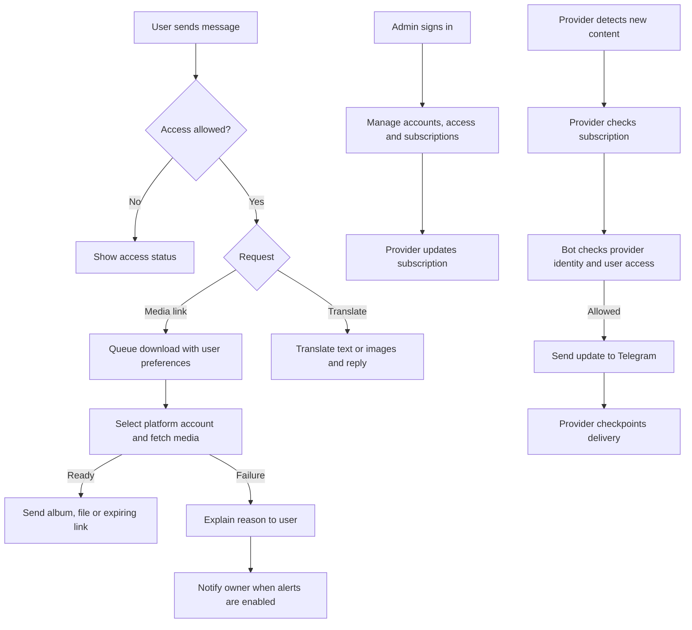

# Telegram Social Downloader

Download media in Telegram and receive subscriptions from connected services. The worker handles Instagram posts and Stories, TikTok, X, Threads, and YouTube videos and Shorts. An HTTPS web console manages the bot.

## What users can do

| In Telegram | Result |
| --- | --- |
| Open a private chat and send `/start` | Register with the bot. Access follows the operator’s approval policy. |
| Send a supported link, or several links together | Receive the media in the chat. The bot groups compatible photos and videos into albums and can deliver other files as documents. |
| Use `/download` in a registered group | Download from the message or its quoted content. The worker checks the requesting member’s access. |
| Change download preferences | Choose Instagram and TikTok content scope, Instagram Story scope, and supported video quality and HDR preferences for new requests. |
| Request a translation | Translate text or supported images in a private chat or registered group when a translation API key is configured. |
| Receive updates from a subscribed service | The provider selects recipients and submits updates for delivery through the bot. |
| Read a status or failure message | See the result in Telegram, including the reason when a request cannot finish. |

## What administrators can do

| Control | Actions |
| --- | --- |
| Users and groups | Review requests, approve or revoke users, set the access policy and manage registered groups. The configured owner has additional Telegram controls. |
| Subscriptions | View connected providers and change a user’s subscription. Providers keep their own subscriber lists and delivery progress. |
| Account pools | Import or update platform cookies, enable or disable an account, select a primary account or rotation policy, and test an account against a supplied post. |
| APIs | Configure the bot token, Telegram Local Bot API credentials and translation API keys. |
| Operations | Pause or resume downloads, adjust platform limits and manage failure notifications. A failure alert includes the reason. |

## How actions flow



## Deploy on Linux

Install on your own server, then enable **Deploy to production** in your fork to install published releases automatically or select a release from Actions. See the [deployment guide](docs/deployment.md).

## Install

Use Linux, Python 3.11 or later, and FFmpeg with ffprobe. Install Deno on the worker’s PATH for YouTube extraction. Use a dedicated operating system account. The example runs the bot components under that account.

```sh
python3 -m venv .venv
. .venv/bin/activate
python -m pip install .
install -d -m 700 /srv/telegram/data /srv/telegram/credentials /srv/telegram/run
install -m 600 .env.example .env
python -m media_bot.admin_auth
```

Copy the verifier to `MEDIA_BOT_ADMIN_PASSWORD_HASH`. Set your bot token, numeric owner ID, HTTPS origin and service paths in `.env`. For a web prefix, use a trailing slash, for example `MEDIA_BOT_BASE=/telegram/`. Point an HTTPS reverse proxy at the web listener on loopback. Preserve the path prefix and request Origin, and disable access logging for capability download URLs.

Start each long-running component under a separate supervisor unit or in its own shell, using the same environment file.

```sh
telegram-social-downloader --env-file .env broker
telegram-social-downloader --env-file .env web
telegram-social-downloader --env-file .env worker
```

Open the configured HTTPS URL to sign in. Sessions expire after three days. Configure platform accounts and translation keys in the console. On Linux, a supervisor can supply the file with `EnvironmentFile=` and omit the CLI option. Keep the credential directory and environment file readable only by their owner.

### Delivery and storage

The official Telegram API is the default. A self-hosted Local Bot API increases the direct-delivery limit to 500 MB. Larger downloads up to 2,000 MB can be delivered through a two-hour link. Set `MEDIA_BOT_API_BASE` to an explicit loopback HTTP endpoint and enable `MEDIA_BOT_LOCAL_FILE_UPLOADS` only if the API daemon can read the worker’s media directory. See [Local Bot API setup](docs/local-api.md).

Put media and temporary files on the same filesystem under `MEDIA_BOT_DATA`. The worker checks available space before downloading. Set `MEDIA_BOT_STORAGE_UUID` to require a specific filesystem. Run `telegram-social-downloader --env-file .env refresh-cookies` periodically to check enabled Instagram sessions.

### Subscription providers

Register each provider in `MEDIA_BOT_PUSH_PROVIDERS` with its own Unix user ID and control socket. Set `MEDIA_BOT_PUSH_SOCKET` to the transport socket and run the push component alongside the bot. See the [provider protocol](docs/push.md).

```sh
telegram-social-downloader --env-file .env push
```

### Tests and releases

```sh
python -m unittest discover -s tests
```

GitHub Actions tests pull requests and pushes to main. A matching version tag such as `v1.0.0` runs the suite and publishes the wheel and source distribution as GitHub Release assets.
