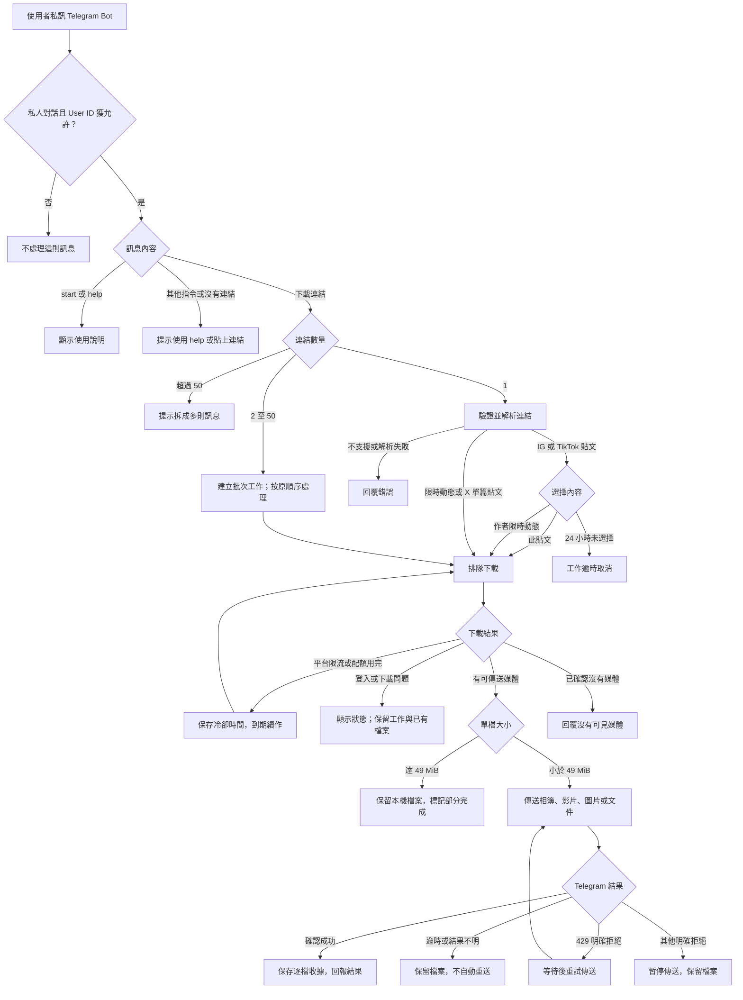
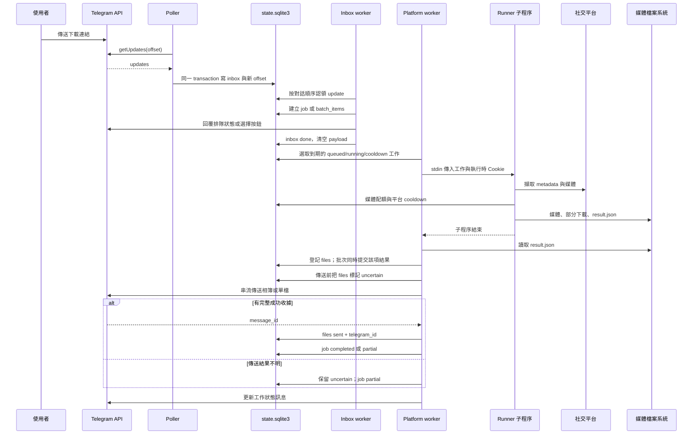
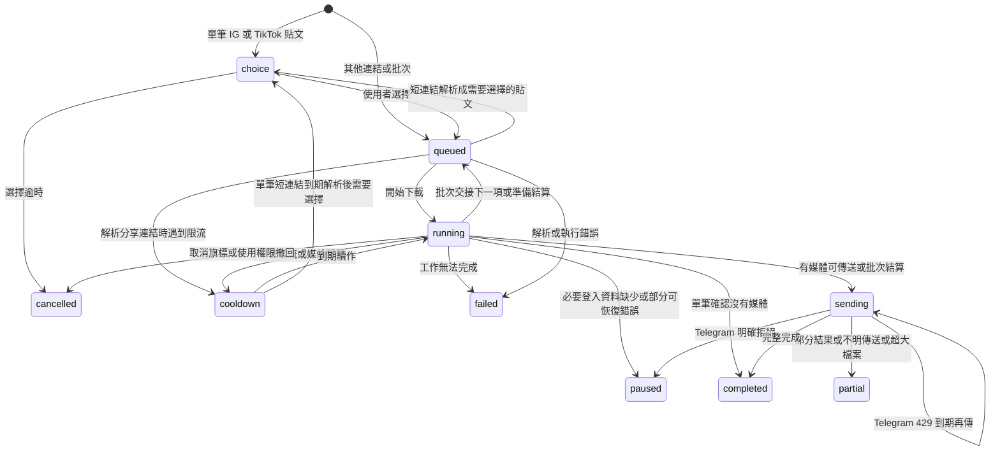
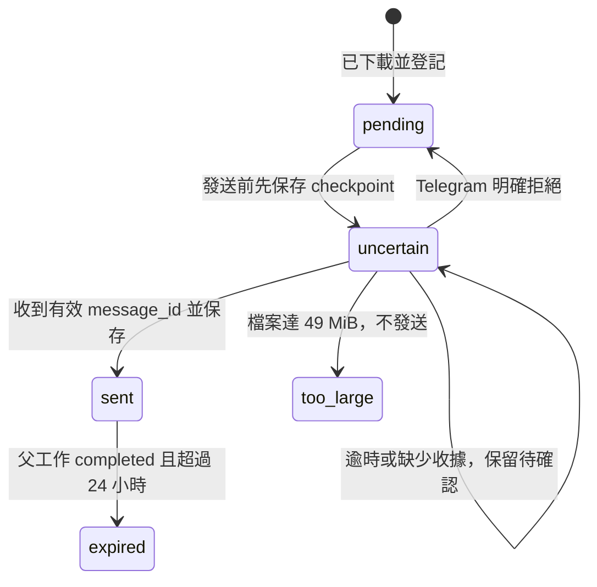
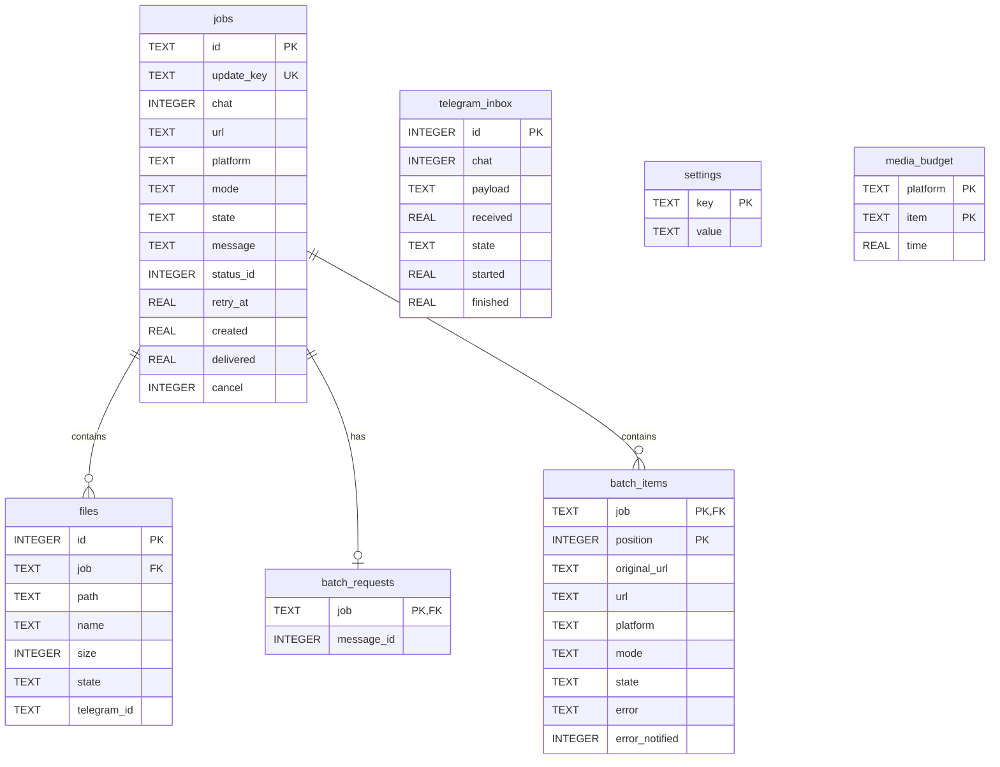
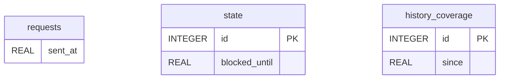

# 使用者流程、背景架構與資料庫

本文對照目前的 [worker.py](../media_bot/worker.py)、[core.py](../media_bot/core.py)、[inbox.py](../media_bot/inbox.py) 與 [instagram_policy.py](../media_bot/instagram_policy.py)，描述實際背景核心行為。平台名稱在資料庫中使用 `instagram`、`tiktok`、`twitter`，其中 `twitter` 即 X。

## 1. User flow：從貼上連結到收到媒體



圖中下載結果是使用者視角的摘要，單筆與批次的精確差異如下：

- **單筆 IG／TikTok 貼文**提供「此貼文／作者限時動態」選擇；分享短連結先解析，再依最終網址決定是否詢問。
- **批次**的貼文連結直接下載貼文，限時動態連結保留限時動態模式；不逐項詢問。重複連結保留為不同項目，單項失敗可繼續後面的連結。
- **X**只接受單篇貼文。個人頁及搜尋頁會被拒絕。
- **空結果**不是一律成功：單筆確認無媒體可完成；批次項目的無媒體結果記為 `failed`，父工作最後可能是 `partial`。
- 缺少必要 Cookie 時，工作會 `paused`。下載中的驗證失敗，單筆會暫停；批次可能將該項記為失敗後繼續。更新外部 Cookie 後可重新提交連結。
- 媒體傳送的 400 拒絕可能先退回逐檔或文件形式；429 等待重試，其他明確拒絕暫停。網路逾時、5xx 或缺少有效收據視為結果不明。
- 最多 100 個 active 工作；達上限會拒絕新工作。使用者等待選擇的工作亦計入。

## 2. 背景處理與資料流



執行緒是 1 個 Telegram poller、4 個 inbox consumers、每個平台 1 個下載 worker；主迴圈約每 30 秒監督執行緒及做維護。每個平台依序處理工作，不同平台可以同時下載；批次父工作依目前項目切換所屬平台。下載器在獨立子程序中執行。

| 內容類型 | 實際引擎與相關模組 |
| --- | --- |
| Instagram | `gallery_runner` → gallery-dl + `instagram_web_gallery`／`instagram_web_client`；`instagram_policy` 限制 API 請求。 |
| TikTok 影片貼文 | `gallery_runner` → `yt_runner` → yt-dlp；優先 HTTPS 完整 H.264 MP4，沒有符合格式才使用原有直接下載備援。 |
| TikTok 照片／限時動態 | `gallery_runner` → gallery-dl + `tiktok` adapter。 |
| X 貼文 | `gallery_runner` → `twitter_runner` → twscrape；媒體另由 HTTP 客戶端串流下載。 |

TikTok 的 H.264／`avc1` 偏好優先於解析度，再於符合格式中選擇最佳版本；沒有 H.264 完整影音時，依序選其他 HTTPS MP4、其他 HTTPS 完整影音、HTTP 完整影音。這條路徑不合併、不轉碼、不強制 720p，亦不保證檔案低於 49 MiB。既有下載與傳送檢查點保持原樣，不自動替換已完成檔案。

## 3. 工作與檔案狀態



此圖呈現主要路徑。取消旗標／權限撤回也能影響其他 active 狀態；本核心的 Telegram 指令只提供 `/start`、`/help` 及下載選擇。`paused`、`partial`、`failed` 不會被平台迴圈自動重新挑選；程序重啟會恢復可執行狀態，並將曾留下 `uncertain` 檔案的工作設為 `partial`。



`uncertain` 同時是發送前的防重送 checkpoint 和傳送結果不明時保留的狀態，不能單憑它判斷對方已收到或未收到。SQLite transaction 與 Telegram 網路傳送不能一起原子提交，因此這個設計**不保證 exactly-once delivery**；它以避免自動重複傳送為優先。

## 4. `state.sqlite3` ER diagram



ER 圖顯示應用使用的關聯；精確 nullable、default、UNIQUE 與 FK 定義以 [state-schema.sql](state-schema.sql) 為準。只有三條 `job → jobs.id` 關聯是真正資料庫外鍵。`telegram_inbox` 與 `jobs` 透過程式產生的 `update_key` 關聯，**沒有 FK**；`chat` 是 Telegram ID，沒有本機 users 表。`settings`、`media_budget` 亦沒有指向 jobs 的外鍵。

### jobs：每次下載請求的父工作

| 欄位 | 意義 |
| --- | --- |
| `id` | 隨機 16 字元十六進位工作 ID，主鍵。 |
| `update_key` | 唯一入列鍵；單筆為 update ID 加連結序號，批次為 update ID 加 `:batch`，防止同一 update 重複建工作。不是 URL 去重。 |
| `chat` | 使用者的 Telegram 私人 chat ID；也是回傳目的地。 |
| `url` | 單筆目前使用的網址；批次父工作初始化時保存第一個有效項目網址，逐項網址以 `batch_items` 為準。 |
| `platform` | 單筆的平台；批次目前應由哪個平台 worker 處理，交接時會改變。 |
| `mode` | `choice`、`resolve`、`post`、`stories` 或 `batch`。 |
| `state` | 工作狀態，見前述 state diagram。 |
| `message` | 最近的使用者狀態文字，預設空字串。 |
| `status_id` | 可被編輯的 Telegram 進度訊息 ID。 |
| `retry_at` | Unix 秒；最早可再次選取的時間，預設 0。 |
| `created` | 工作建立的 Unix 秒。 |
| `delivered` | 完成傳送結算時的 Unix 秒；`partial` 也可能有值，不能單靠它證明所有媒體均送達。 |
| `cancel` | 取消旗標，預設 0。 |

### files：本機媒體與 Telegram 收據

| 欄位 | 意義 |
| --- | --- |
| `id` | INTEGER 主鍵。 |
| `job` | 所屬父工作 ID，FK 至 `jobs.id`。 |
| `path` | 本機媒體路徑；讀取／清理時必須位於資料目錄的 `media` 下。 |
| `name` | 傳送時使用的檔名。 |
| `size` | 登記時的 byte 大小。 |
| `state` | `pending`、`uncertain`、`sent`、`too_large` 或 `expired`。 |
| `telegram_id` | 成功傳送的 Telegram **message_id**，以文字保存；不是 Telegram file_id。 |

`UNIQUE(job, path)` 防止同一工作重複登記同一路徑。批次檔案仍只 FK 到父工作，**沒有 batch item FK**；目錄中的 `item-<position>` 區分下載來源。

### batch_requests 與 batch_items：一則訊息的多個連結

| 表／欄位 | 意義 |
| --- | --- |
| `batch_requests.job` | 主鍵及 FK，一個批次父工作至多一列。 |
| `batch_requests.message_id` | 使用者原始訊息 ID，用於回覆單項錯誤。 |
| `batch_items.job` + `position` | 複合主鍵；position 從 0 起，維持連結順序。job 亦為 FK。 |
| `original_url` | 收到的原始連結，用於錯誤回覆。 |
| `url` | 驗證／解析後目前使用的網址。 |
| `platform`、`mode` | 該項目的平台及下載模式；解析分享連結後可更新。 |
| `state` | `pending`、`done` 或 `failed`；父工作另記 `running`，子項不使用 running 狀態。 |
| `error` | 該項的失敗／無媒體說明，預設空字串。 |
| `error_notified` | 0：尚待通知；1：已先設 checkpoint，可能傳送中或結果不明；2：已確認通知成功。這不是 Boolean。 |

### telegram_inbox：持久收件匣

| 欄位 | 意義 |
| --- | --- |
| `id` | Telegram update_id，INTEGER 主鍵，用於去重。 |
| `chat` | 對話 ID，用於同一對話內的順序處理。 |
| `payload` | 尚待處理的 update JSON；完成或結果不明後清為空字串。 |
| `received`、`started`、`finished` | 接收、認領及處理結束的 Unix 秒。 |
| `state` | `pending`、`working`、`done` 或 `uncertain`。 |

`telegram_inbox_order(chat, state, id)` 支援順序挑選；待處理／處理中的容量上限為 1000。重啟時 `working` 轉為 `uncertain`，不直接重播可能已送出回覆的 handler。結束超過 24 小時的非 active 收件紀錄可清理。

### settings 與 media_budget：執行狀態與配額

| 表／欄位 | 意義 |
| --- | --- |
| `settings.key` | 文字主鍵。 |
| `settings.value` | JSON 編碼的文字值；不是 SQL JSON 型別。 |
| `media_budget.platform` + `item` | 複合主鍵；平台加媒體路徑識別，在同一時間窗內避免重複預留。 |
| `media_budget.time` | 配額預留的 Unix 秒；`media_budget_time(platform, time)` 為查詢索引。 |

常用 settings keys：`enabled`、`telegram_offset`、`telegram_health`、`telegram_last_poll`、`<platform>_cooldown`、`<platform>_media_limit`、`partial:<job>`、`partial_reason:<job>`。預設每平台每滾動 60 秒允許 20 個新媒體預留；它與 Instagram 的 API 請求限速是兩個獨立限制。

## 5. `instagram-api-rate.sqlite3` schema



| 表 | 用途與約束 |
| --- | --- |
| `requests` | 每次 API 請求預留的 `sent_at`；NOT NULL，沒有顯式主鍵或索引。保留約一小時紀錄。 |
| `state` | 單列 `id=1`，由 CHECK 限制；`blocked_until` 為持久冷卻期限。 |
| `history_coverage` | 單列 `id=1`，由 CHECK 限制；`since` 表示歷史資料已知的起點，避免把缺漏歷史當成零請求。 |

這三表沒有外鍵。精確 DDL 見 [instagram-rate-schema.sql](instagram-rate-schema.sql)。`RequestWindow` 另以目前時間初始化單列狀態，因此 DDL 文件只有結構，不可代替應用啟動程序。實際 Instagram adapter 明確設定 **每分鐘最多 10 次 API 請求、至少相隔 6 秒**，計算額外加 0.05 秒邊界；與 `instagram_policy.py` 通用類別的預設 12 次／5 秒不同。

## 6. 資料與恢復界線

```text
MEDIA_BOT_DATA/
  state.sqlite3                 工作、收件、傳送與配額
  state.sqlite3-wal / -shm       主 DB 的 WAL 輔助檔，存在時須一併考量
  instagram-api-rate.sqlite3    Instagram API 請求歷史
  media/
    <job-id>/                   單筆工作媒體與 result.json
    <job-id>/item-<position>/    批次項目媒體與 result.json
  tmp/                          子程序使用的暫存目錄
```

- 主 DB 使用 WAL，`core.db()` 開啟 foreign keys；限速 DB 使用獨立 SQLite 連線，程式沒有為它設定 WAL。所有 REAL 時間欄位是 Unix 秒，對外冷卻提示使用 UTC。
- 狀態字串及平台／模式值由程式維持，主 DB 沒有 ENUM／CHECK 約束；精確 nullable 和 defaults 保留在 DDL，不推測成額外約束。
- Token／Cookie 由外部受限檔案載入，沒有資料庫憑證欄位。媒體內容存在檔案系統，沒有存進 SQLite BLOB。
- 至少保留 5 GiB 可用空間，媒體暫存達 3 GiB 時拒絕新增下載。單筆空間／執行錯誤可能成為 `failed`；批次對部分儲存問題設為 `paused`。這兩種狀態不會自動被選取。
- 清理只刪除 `files.state=sent`、父工作 `completed` 且 `delivered` 超過 24 小時的媒體，每輪最多 16 個。`partial`、`uncertain`、`too_large` 媒體保留；jobs／files metadata 沒有同時刪除。
- X 的 `.receipt.json` 保存媒體大小與 SHA-256，用來驗證下載檔案；SQLite 的 `telegram_id` 則證明 Telegram 回覆成功。兩種收據證明不同階段。
- 本文件及 SQL 是從程式整理的開發參考；SQL 可在全新隔離 DB 檢查結構，日常啟動仍交由程式初始化，不應當作現有資料的重設或 migration 指令。
